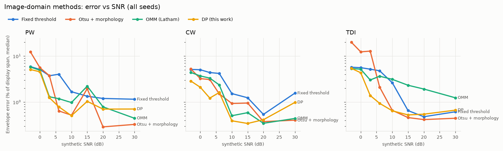
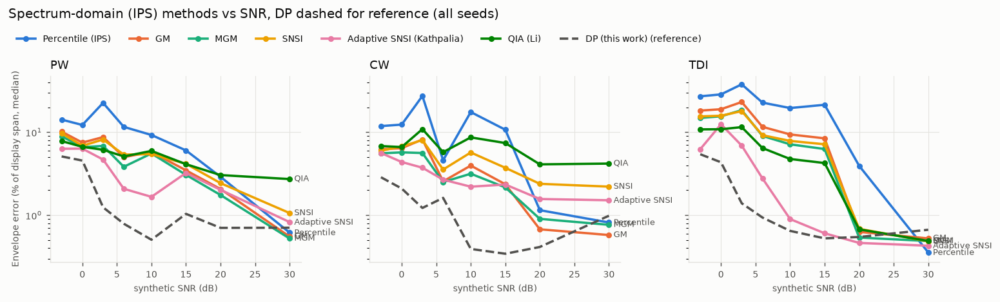
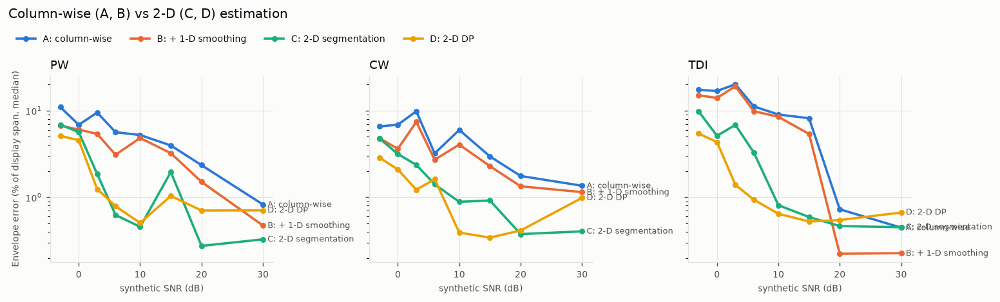
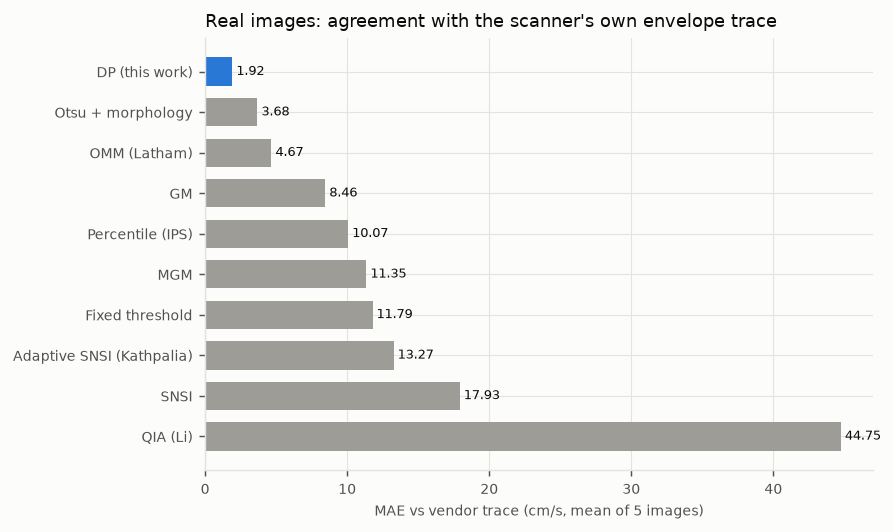

# Doppler envelope benchmark report

> Copy of `C:\Claude\Doppler\results\report\REPORT.md` from the 2026-09-29 run (raw CSVs stay outside the repo). Regenerate with `scripts/make_report.py`; section 9 is hand-written.
esults
eport\REPORT.md` from the 2026-09-29 run (raw CSVs stay outside the repo). Regenerate with `scripts/make_report.py`; section 9 is hand-written.

Generated by `scripts/make_report.py`. Primary endpoint (fixed before the benchmark was run): **normalised envelope MAE** = mean |error| of v_max and v_min, divided by the display velocity span, over samples with data. Synthetic results are reported on the held-out split (seed 1) unless noted; the dev split (seed 0) is shown alongside. Failure = normalised MAE > 5%. 192 synthetic cases, 0 failed runs.

## 1. Main benchmark (synthetic, held-out split)

|                           |   nmae_median |   nmae_mean |   nmae_p95 |   mae_cm_s |   vmax_rmse |   bias_vmax |   peak_abs_err |   vti_rel_err |   t_peak_err_ms |   failure |   mean_env_nmae |   runtime_ms |   low_snr_nmae |
|:--------------------------|--------------:|------------:|-----------:|-----------:|------------:|------------:|---------------:|--------------:|----------------:|----------:|----------------:|-------------:|---------------:|
| DP (this work)            |         0.012 |       0.021 |      0.062 |      2.558 |       5.064 |      -0.433 |          4.243 |         0.172 |          13.205 |     0.125 |           0.009 |      389.376 |          0.024 |
| OMM (Latham)              |         0.016 |       0.024 |      0.066 |      2.766 |       4.450 |      -0.797 |          6.953 |         0.271 |          13.205 |     0.167 |           0.013 |      435.541 |          0.033 |
| Otsu + morphology         |         0.017 |       0.055 |      0.259 |      5.225 |       7.226 |       0.229 |          4.588 |         0.137 |          15.076 |     0.271 |           0.013 |      276.292 |          0.068 |
| Adaptive SNSI (Kathpalia) |         0.031 |       0.039 |      0.107 |      8.057 |      10.615 |      -0.435 |          8.535 |         0.244 |         133.811 |     0.271 |           0.017 |      701.018 |          0.059 |
| Fixed threshold           |         0.032 |       0.033 |      0.067 |      6.941 |      10.384 |      -1.072 |         18.897 |         0.636 |         170.785 |     0.240 |           0.023 |      144.390 |          0.051 |
| MGM                       |         0.045 |       0.065 |      0.192 |      8.902 |      13.700 |       2.241 |         12.311 |         0.381 |         191.472 |     0.458 |           0.030 |      222.769 |          0.089 |
| GM                        |         0.051 |       0.082 |      0.260 |     10.042 |      13.330 |       4.041 |         13.392 |         0.435 |         198.515 |     0.521 |           0.030 |      239.047 |          0.102 |
| SNSI                      |         0.054 |       0.077 |      0.219 |     12.336 |      19.071 |       1.764 |         16.974 |         0.387 |         191.913 |     0.562 |           0.037 |      628.732 |          0.097 |
| QIA (Li)                  |         0.058 |       0.065 |      0.132 |     11.422 |      23.002 |      -0.211 |         27.863 |         0.560 |         246.493 |     0.573 |           0.039 |      334.375 |          0.093 |
| Percentile (IPS)          |         0.104 |       0.150 |      0.397 |     17.379 |      34.866 |      12.319 |         29.875 |         1.291 |         301.074 |     0.667 |           0.045 |      180.889 |          0.200 |

*nmae* = normalised envelope MAE; *mae_cm_s* = median MAE in cm/s (depends on modality range); *peak_abs_err* = per-beat |peak velocity error| of v_max (cm/s); *vti_rel_err* = per-beat relative VTI error; *t_peak_err_ms* = per-beat time-to-peak error; *mean_env_nmae* = normalised MAE of the three mean envelopes. *runtime_ms* is the estimator time measured while 12 benchmark processes ran in parallel; the full pipeline takes ~0.2 s per 1024x768 image on an idle machine.

### Spectral Doppler (PW + CW): median normalised envelope MAE by SNR band

|                           |   low (<=3 dB) |   medium (6-15 dB) |   high (>=20 dB) |
|:--------------------------|---------------:|-------------------:|-----------------:|
| Fixed threshold           |          0.049 |              0.025 |            0.011 |
| Otsu + morphology         |          0.061 |              0.011 |            0.004 |
| OMM (Latham)              |          0.032 |              0.011 |            0.005 |
| Percentile (IPS)          |          0.176 |              0.086 |            0.011 |
| GM                        |          0.081 |              0.045 |            0.006 |
| MGM                       |          0.075 |              0.037 |            0.008 |
| SNSI                      |          0.080 |              0.051 |            0.022 |
| Adaptive SNSI (Kathpalia) |          0.056 |              0.024 |            0.013 |
| QIA (Li)                  |          0.086 |              0.057 |            0.032 |
| DP (this work)            |          0.022 |              0.007 |            0.005 |

### Tissue Doppler (TDI): median normalised envelope MAE by SNR band

|                           |   low (<=3 dB) |   medium (6-15 dB) |   high (>=20 dB) |
|:--------------------------|---------------:|-------------------:|-----------------:|
| Fixed threshold           |          0.057 |              0.018 |            0.005 |
| Otsu + morphology         |          0.216 |              0.008 |            0.006 |
| OMM (Latham)              |          0.043 |              0.025 |            0.013 |
| Percentile (IPS)          |          0.325 |              0.311 |            0.012 |
| GM                        |          0.204 |              0.145 |            0.006 |
| MGM                       |          0.173 |              0.105 |            0.005 |
| SNSI                      |          0.167 |              0.117 |            0.006 |
| Adaptive SNSI (Kathpalia) |          0.094 |              0.013 |            0.005 |
| QIA (Li)                  |          0.113 |              0.067 |            0.006 |
| DP (this work)            |          0.040 |              0.006 |            0.006 |

## 2. Paired comparison with DP (held-out split, per-image normalised MAE)

| method                    |   median diff (DP - method) |   95% CI low |   95% CI high |   fraction of images DP better |       n |
|:--------------------------|----------------------------:|-------------:|--------------:|-------------------------------:|--------:|
| Fixed threshold           |                     -0.0060 |      -0.0101 |       -0.0025 |                         0.7604 | 96.0000 |
| Otsu + morphology         |                      0.0001 |      -0.0021 |        0.0008 |                         0.4896 | 96.0000 |
| OMM (Latham)              |                     -0.0007 |      -0.0015 |       -0.0000 |                         0.6042 | 96.0000 |
| Percentile (IPS)          |                     -0.0626 |      -0.1141 |       -0.0412 |                         0.8854 | 96.0000 |
| GM                        |                     -0.0159 |      -0.0331 |       -0.0057 |                         0.8229 | 96.0000 |
| MGM                       |                     -0.0142 |      -0.0256 |       -0.0050 |                         0.8229 | 96.0000 |
| SNSI                      |                     -0.0240 |      -0.0356 |       -0.0160 |                         0.8750 | 96.0000 |
| Adaptive SNSI (Kathpalia) |                     -0.0123 |      -0.0148 |       -0.0072 |                         0.8229 | 96.0000 |
| QIA (Li)                  |                     -0.0355 |      -0.0437 |       -0.0226 |                         0.9062 | 96.0000 |

## 3. Spectral vs tissue Doppler x SNR interaction

Delta = (MAE_TDI,low - MAE_TDI,high) - (MAE_spec,low - MAE_spec,high), medians of normalised MAE; low = SNR <= 3 dB, high = SNR >= 20 dB. Positive: TDI degrades more with falling SNR.

| method                    |   spec high |   spec low |   TDI high |   TDI low |   Delta |
|:--------------------------|------------:|-----------:|-----------:|----------:|--------:|
| Fixed threshold           |      0.0088 |     0.0499 |     0.0053 |    0.0551 |  0.0087 |
| Otsu + morphology         |      0.0034 |     0.0544 |     0.0045 |    0.1702 |  0.1148 |
| OMM (Latham)              |      0.0044 |     0.0423 |     0.0149 |    0.0507 | -0.0022 |
| Percentile (IPS)          |      0.0115 |     0.1719 |     0.0123 |    0.3345 |  0.1618 |
| GM                        |      0.0063 |     0.0761 |     0.0058 |    0.2142 |  0.1385 |
| MGM                       |      0.0074 |     0.0662 |     0.0052 |    0.1750 |  0.1110 |
| SNSI                      |      0.0208 |     0.0722 |     0.0057 |    0.1767 |  0.1195 |
| Adaptive SNSI (Kathpalia) |      0.0134 |     0.0560 |     0.0046 |    0.0698 |  0.0225 |
| QIA (Li)                  |      0.0323 |     0.0717 |     0.0058 |    0.1117 |  0.0665 |
| DP (this work)            |      0.0056 |     0.0261 |     0.0063 |    0.0396 |  0.0129 |

## 4. Does 2-D information help? (Plan section 54)

A = independent column-wise estimate, B = A + 1-D smoothing, C = 2-D segmentation + boundary, D = 2-D likelihood + globally optimised curve. All seeds.

| variant                     |   low (<=3 dB) |   medium (6-15 dB) |   high (>=20 dB) |
|:----------------------------|---------------:|-------------------:|-----------------:|
| A_colwise_asnsi_raw         |          0.086 |              0.044 |            0.011 |
| A_colwise_mgm_nogate        |          0.177 |              0.130 |            0.119 |
| A_colwise_percentile        |          0.197 |              0.081 |            0.011 |
| A_colwise_qia_fullcolumn    |          0.092 |              0.039 |            0.007 |
| A_colwise_qia_nogate        |          0.126 |              0.113 |            0.102 |
| B_colwise_asnsi_median      |          0.064 |              0.030 |            0.009 |
| B_colwise_percentile_kalman |          0.168 |              0.079 |            0.018 |
| B_colwise_percentile_median |          0.185 |              0.054 |            0.007 |
| C_segmentation              |          0.051 |              0.009 |            0.003 |
| D_dp                        |          0.028 |              0.006 |            0.006 |
| D_dp_savgol                 |          0.027 |              0.006 |            0.006 |

## 5. Ablations (synthetic, all seeds; vendor traces where available)

| variant              |   synthetic_nmae_median |   synthetic_nmae_mean |   low_snr |   mean_env_nmae |   vendor_mae_cm_s |
|:---------------------|------------------------:|----------------------:|----------:|----------------:|------------------:|
| abl1_raw_fixed       |                   0.032 |                 0.033 |     0.051 |           0.023 |            11.785 |
| abl2_smooth_fixed    |                   0.035 |                 0.036 |     0.050 |           0.029 |             8.295 |
| abl3_smooth_otsu     |                   0.034 |                 0.099 |     0.273 |           0.021 |             3.443 |
| abl4_+morphology     |                   0.018 |                 0.043 |     0.056 |           0.013 |             3.681 |
| abl5_+components     |                   0.014 |                 0.031 |     0.051 |           0.011 |             3.900 |
| abl6_+largest_run    |                   0.018 |                 0.030 |     0.052 |           0.012 |             4.200 |
| abl7_bg_threshold    |                   0.028 |                 0.044 |     0.055 |           0.017 |            26.851 |
| abl8_+dp_tracking    |                   0.012 |                 0.021 |     0.031 |           0.008 |             1.948 |
| dp                   |                   0.011 |                 0.021 |     0.028 |           0.008 |             1.916 |
| dp_fixed_accel       |                   0.013 |                 0.022 |     0.033 |           0.009 |             1.982 |
| dp_hard_membership   |                   0.012 |                 0.021 |     0.031 |           0.008 |             1.948 |
| dp_matlab_split      |                   0.041 |                 0.038 |     0.052 |           0.028 |             2.228 |
| dp_mean_level_w      |                   0.011 |                 0.021 |     0.028 |           0.009 |             1.916 |
| dp_mean_membership_w |                   0.011 |                 0.021 |     0.028 |           0.011 |             1.916 |
| dp_no_bgcorr         |                   0.010 |                 0.033 |     0.034 |           0.008 |             2.071 |
| dp_no_click_bridge   |                   0.012 |                 0.022 |     0.034 |           0.008 |             1.921 |
| dp_no_density        |                   0.032 |                 0.090 |     0.057 |           0.022 |             2.391 |
| dp_no_normalise      |                   0.029 |                 0.031 |     0.052 |           0.020 |             1.916 |
| dp_no_wallband       |                   0.015 |                 0.023 |     0.032 |           0.010 |             1.916 |
| dp_split_cost        |                   0.028 |                 0.030 |     0.047 |           0.015 |             2.054 |
| dp_theta_0.2         |                   0.022 |                 0.089 |     0.186 |           0.012 |             4.710 |
| dp_theta_0.35        |                   0.010 |                 0.030 |     0.039 |           0.008 |             3.008 |
| dp_theta_0.65        |                   0.018 |                 0.024 |     0.037 |           0.012 |             2.062 |

## 6. Real images with vendor ground truth (5 vascular, Philips iU22)

Vendor auto-trace drawn on the display, masked out before estimation. Per column the trace is compared with v_max (trace > 0) or v_min (trace < 0). DP edge density was chosen by leave-one-image-out on these images (held-out MAE 2.16 cm/s); all other methods use published/default settings.

|                           |   4264RW7J |   4264S19Z |   4264S3EL |   4264S7VX |   4264SA3K |   mean |   bias |   corr |
|:--------------------------|-----------:|-----------:|-----------:|-----------:|-----------:|-------:|-------:|-------:|
| DP (this work)            |       1.05 |       1.19 |       1.53 |       1.08 |       4.73 |   1.92 |  -0.68 |   0.99 |
| Otsu + morphology         |       2.26 |       2.42 |       0.94 |       3.51 |       9.28 |   3.68 |   2.03 |   0.95 |
| OMM (Latham)              |       2.95 |       2.87 |       1.42 |       4.60 |      11.50 |   4.67 |   2.23 |   0.95 |
| GM                        |       4.04 |       5.25 |       1.75 |       3.29 |      27.97 |   8.46 |   6.44 |   0.91 |
| Percentile (IPS)          |       5.88 |       6.84 |       4.34 |       5.88 |      27.42 |  10.07 |   5.96 |   0.96 |
| MGM                       |       5.28 |       5.87 |       2.54 |       4.24 |      38.83 |  11.35 |   8.64 |   0.86 |
| Fixed threshold           |       2.24 |       1.27 |      41.46 |       2.94 |      11.02 |  11.79 |  10.39 |   0.78 |
| Adaptive SNSI (Kathpalia) |       6.47 |       6.19 |       3.15 |       4.94 |      45.59 |  13.27 |  10.04 |   0.87 |
| SNSI                      |       6.95 |       6.45 |       3.19 |       4.99 |      68.05 |  17.93 |  14.66 |   0.78 |
| QIA (Li)                  |      16.73 |       9.93 |      27.50 |      13.43 |     156.19 |  44.75 |  28.38 |   0.58 |

## 7. Real cardiac images without reference (unsupervised)

44 images. Without ground truth only consistency can be measured: agreement with the other methods (median over methods of the mean |difference|, cm/s), sample-to-sample jitter (S1, cm/s per sample) and runtime. Low jitter alone is not accuracy.

|                           |   jitter_vmax |   jitter_vmin |   runtime_ms |   median_disagreement_cm_s |   vs_dp_cm_s |
|:--------------------------|--------------:|--------------:|-------------:|---------------------------:|-------------:|
| Adaptive SNSI (Kathpalia) |          2.09 |          2.67 |       184.10 |                       7.37 |        16.94 |
| DP (this work)            |          1.11 |          1.21 |        99.70 |                      14.17 |       nan    |
| GM                        |          3.30 |          4.13 |        65.18 |                       6.83 |        15.71 |
| OMM (Latham)              |          0.65 |          0.79 |       131.04 |                      10.46 |         9.69 |
| MGM                       |          3.27 |          3.85 |        60.29 |                       6.80 |        17.03 |
| Otsu + morphology         |          1.27 |          1.41 |        78.59 |                       9.70 |         7.41 |
| Percentile (IPS)          |          3.48 |          5.40 |        50.36 |                      11.58 |        17.54 |
| QIA (Li)                  |          5.31 |          4.88 |        84.29 |                      26.77 |        38.67 |
| SNSI                      |          3.88 |          4.47 |       152.52 |                       7.82 |        18.11 |
| Fixed threshold           |          3.45 |          3.55 |        48.55 |                      13.26 |         6.14 |

## 8. How hard are the real images? (image-domain SNR proxy)

Median SNR proxy (dB) of the synthetic images per nominal SNR, to place real images on the synthetic SNR axis (the real images' proxies are listed in the QC summaries):

|   snr_db |   synthetic SNR proxy (dB) |
|---------:|---------------------------:|
|     -3.0 |                        3.5 |
|      0.0 |                        4.2 |
|      3.0 |                        2.7 |
|      6.0 |                        5.2 |
|     10.0 |                        7.6 |
|     15.0 |                       10.9 |
|     20.0 |                       14.6 |
|     30.0 |                       22.7 |
## 9. Conclusions (run of 2026-09-29)

**Which estimator is most accurate?** The DP method, on both references:
- **Real images, scanner auto-traces (5 vascular):** MAE 1.92 cm/s, correlation 0.99. The next best are Otsu (3.68) and OMM (4.67). The spectrum methods reach 8-45 cm/s. The DP edge level was tuned on these 5 images; the held-out estimate is 2.16 cm/s, still the best.
- **Synthetic, held-out split:** median normalised error 1.2% of the display span, with the lowest failure rate (12.5%). In the paired comparison it is better than every spectrum method (bootstrap CI excludes 0). Against OMM the advantage is small (CI up to 0.0000), and it is equivalent to Otsu (CI includes 0).

**How does the ranking change with SNR?**
- **High SNR (>= 20 dB):** the image methods (Otsu, OMM, DP) are equivalent (0.4-0.6% of span). GM and MGM are close on synthetic data (0.6-0.8%).
- **Low SNR (<= 3 dB):** DP has the lowest error: 2.2% spectral and 4.0% TDI, against OMM 3.2% / 4.3%, Otsu 6.1% / 21.6% and the spectrum methods 5.6-33%.

The real images have SNR proxies of 15-43 dB. That is at or above the synthetic 20-30 dB range (proxy 15-23 dB). So on these data the practical differences come less from noise than from rendering effects (clutter, mirror bands, clicks, text, sweep, colour maps). The vendor traces separate the methods much more strongly than synthetic high-SNR cases do.

**Does one detector work for spectral Doppler and TDI?** Yes, for DP and OMM. With the same parameters, the extra degradation of TDI at low SNR (Delta) is 0.013 for DP and -0.002 for OMM. It is 0.02-0.16 for Otsu and the spectrum methods (adaptive SNSI 0.02, the others 0.07-0.16). Density normalisation was the component that made one DP parameter set work for dense (vascular/CW) and sparse (TDI) renderings.

**Hypotheses:**
- H1 (spectrum methods competitive at high SNR): supported on synthetic data (GM/MGM within 0.1-0.3% of span of DP). Not supported on real images, where they are 4-23x worse than DP against the vendor traces.
- H2 (image methods degrade more gracefully): supported.
- H3 (global curve tracking beats column-wise at low SNR): supported. At <= 3 dB: A 8.6% > B 6.4% > C 5.1% > D 2.8%. At high SNR, C (segmentation) is marginally better than D.
- H4 (one architecture for spectral and TDI): supported for DP (small Delta, one parameter set).
- H5 (hybrid image-domain method best): supported.

**Which DP components matter?** In order, on synthetic median / low-SNR / vendor MAE:
- the outer-edge cost instead of the MATLAB split: split 4.1% vs 1.1%, vendor 2.23 vs 1.92;
- density normalisation: 2.9% vs 1.1%;
- local density: 3.2% vs 1.1%;
- the calibrated edge level: theta 0.2 gives 4.7 cm/s on vendor traces;
- the wall band, background correction, click bridging and the range-scaled acceleration prior each add 0.4-0.6 percentage points at low SNR.

Soft vs hard membership barely matters once the density is normalised. The weighting choice for the mean envelopes (power, level or membership) changes the mean-envelope error only marginally (0.8-1.1% of span).

**Limitations:**
- The synthetic truth is my own rendering model.
- The only real ground truth is 5 vascular PW images. The edge convention on cardiac CW jets (dense core vs faint tail) is not validated.
- Mirror artefacts are reported as flow.
- Aliasing is flagged but not corrected.
